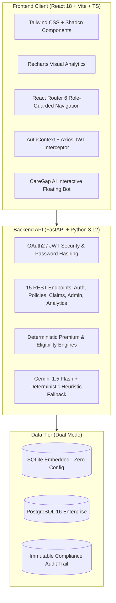

# CareGap AI – AI-Powered Dual Income Protection Platform for Professional Caregivers

[](https://fastapi.tiangolo.com)
[](https://react.dev)
[](https://www.typescriptlang.org)
[](https://tailwindcss.com)
[](https://ai.google.dev/)
[](https://www.docker.com)
[](https://pytest.org)
[](https://vitest.dev)

> **Academic Insurtech Prototype Notice:**
> CareGap AI is an academic demonstration and research platform exploring specialized income protection models for informal and formal healthcare workers. Simulated insurance contracts, premium quotes, risk ratings, and claim settlements are illustrative prototype values and do not constitute legal contracts under the Insurance Regulatory and Development Authority of India (IRDAI) or applicable insurance regulations.

---

## 1. Project Vision & The Caregiver Dilemma

Professional caregivers—home nurses, elderly companions, palliative attendants, and patient care assistants—form the backbone of domestic and community healthcare. Despite demanding physical and emotional labor, they face severe structural financial vulnerability:

1. **Medical Incapacity Shock:** If a caregiver suffers a fracture, infectious illness, or acute burnout, they cannot work and lose 100% of their daily wages. Traditional health insurance covers hospital bills, but leaves unpaid household rent, groceries, and dependents' needs unaddressed.
2. **Employment Continuity Shock:** Unlike corporate workers, home caregivers face sudden, involuntary job loss when an elderly patient passes away, recovers, or relocates to an intensive care facility.

**CareGap AI** introduces a **Dual-Protection Safety Net** explicitly tailored for this workforce:
- **Option A (Personal Income Protection):** Replaces up to 100% of daily wages during medically certified inability to work due to illness or accidental injury.
- **Option B (Employment Continuity Protection):** Provides transition bridge income when a caregiver involuntarily loses employment through no fault of their own.
- **Dual-Shield Combined Package:** Integrates both protections into a single, low-cost micro-insurance package with AI-assisted underwriting and document processing.

---

## 2. Technology Stack & System Architecture



- **Frontend:** React 18, Vite, TypeScript, Tailwind CSS, Lucide React icons, Recharts analytics, React Hook Form.
- **Backend:** Python 3.12+, FastAPI, SQLAlchemy 2.0 ORM, Pydantic v2 schemas, PyJWT authentication, Bcrypt password hashing.
- **Database:** Dual-engine architecture—zero-config SQLite for instant local runs and unit testing; PostgreSQL 16+ for containerized production deployments.
- **AI Engine:** Google Gemini 1.5 Flash with structured Pydantic schema decoding and deterministic local heuristic fallback.
- **Testing:** 15 automated Pytest backend test cases and 6 Vitest frontend test cases.

---

## 3. Pre-Seeded Demonstration Accounts

The platform includes an auto-seeding engine that initializes the database with **20 users**, **15 caregiver profiles**, **4 licensed care agencies**, **3 configurable plans**, and **11 real-world claims** across all stages.

You can use the **1-Click Instant Login** buttons on the Login page or authenticate manually:

| Role | Email Address | Password | Permissions & Dashboard Features |
|---|---|---|---|
| **Caregiver** | `caregiver@caregap.demo` | `CareGap@2026!` | Profile onboarding, quote engine, policy purchase, claim submission wizard, live claim tracker, AI assistant |
| **Care Agency** | `employer@caregap.demo` | `CareGap@2026!` | Caregiver roster, salary verification, Option B job loss termination dispute/confirmation (medical records strictly hidden) |
| **Administrator** | `admin@caregap.demo` | `CareGap@2026!` | Underwriting review, claim adjudication queue, plan pricing editor, fraud detection alerts, audit logs |

---

## 4. Key Platform Features

### 4.1 Multi-Step Onboarding with Gemini Risk Scoring
- Interactive 4-step wizard capturing demographic, occupational, salary, and banking verification metadata.
- Secure banking module: Never stores banking credentials; masks account numbers (`****5432`) and validates IFSC routing codes.
- Real-time occupational risk scoring powered by Google Gemini 1.5 Flash (evaluating shift work, patient dependency, and experience).

### 4.2 Transparent Quoting & Deterministic Pricing Engine
- **Basic Plan (₹199/mo):** Comprehensive Option A medical income protection.
- **Plus Plan (₹349/mo):** Combined Option A + Option B dual protection.
- **Premium Plan (₹499/mo):** Option A + Option B with extended 60-day payout and health check-up perks.
- Deterministic calculation: Applies category factors (e.g., $1.10\times$ for Home Nurses), tenure stability discounts (up to 10%), and shift risk adjustments.

### 4.3 End-to-End Claims Engine & Workflow State Machine
- **Claim Types:** Option A (medical incapacity with physician certificate) and Option B (involuntary job loss with termination proof).
- **Automated Lifecycle:**
  `SUBMITTED` $\to$ `DOCUMENT_VERIFICATION` $\to$ `EMPLOYMENT_VERIFICATION` $\to$ `UNDER_REVIEW` $\to$ `APPROVED`/`REJECTED` $\to$ `COMPLETED`.
- **Automated Payout Engine:** Calculates billable duration, daily wage entitlement ($\text{Salary} / 30$), and enforces 60-day duration caps.
- **Fraud Anomaly Flags:** Automatically flags claims filed during waiting windows or with conflicting dates.

### 4.4 Strict Role-Based Privacy Separation
- **Medical Privacy Guard:** Agencies and employers can **only** verify Option B termination claims. Option A medical diagnosis records and hospital discharge notes are strictly locked to the Caregiver and Administrator.

### 4.5 CareGap AI Assistant Chatbot
- Contextual, multi-role floating chatbot available on every screen.
- Answers policy questions, clarifies exclusions, calculates hypothetical benefits, and explains waiting periods.

---

## 5. Local Setup & Quickstart

### Prerequisites
- **Python 3.11+** installed (`python --version`)
- **Node.js 18+** & **npm** installed (`node --version`)
- *Optional:* Docker Desktop (for containerized setup)

### Option A: Local Development Setup (Quickest)

#### 1. Clone & Enter Project
```bash
git clone https://github.com/example/caregap-ai.git
cd caregap-ai
```

#### 2. Backend Setup
```bash
# Enter backend directory
cd backend

# Create and activate virtual environment
python -m venv .venv

# Windows Powershell
.venv\Scripts\Activate.ps1
# macOS / Linux
source .venv/bin/activate

# Install dependencies
pip install -r requirements.txt

# Start backend server (Auto-creates and seeds database on first run)
python run.py
```
*Backend runs at: `http://localhost:8000` (Swagger docs at `http://localhost:8000/docs`)*

#### 3. Frontend Setup (In a second terminal)
```bash
# Enter frontend directory
cd frontend

# Install Node dependencies
npm install

# Start Vite development server
npm run dev
```
*Frontend runs at: `http://localhost:5173`*

---

### Option B: Docker Compose Deployment

To launch the full production-ready stack (FastAPI Backend + PostgreSQL + Nginx React Frontend):

```bash
docker compose up --build
```
- Frontend: `http://localhost:3000`
- Backend API: `http://localhost:8000`
- API Documentation: `http://localhost:8000/docs`

---

## 6. Running Automated Tests

### Backend Test Suite (Pytest)
```bash
# From the project root
.\backend\.venv\Scripts\pytest.exe backend\tests -v
```
*Results:* **15 passed tests** covering JWT authentication, deterministic premium formulas, eligibility rules, and AI fallback behavior.

### Frontend Test Suite (Vitest)
```bash
# From the frontend directory
cd frontend
npm test
```
*Results:* **6 passed tests** covering state management, calculation utilities, and component rendering.

### Production Build Verification
```bash
cd frontend
npm run build
```
*Compiles cleanly with zero TypeScript errors into optimized static bundles in `dist/`.*

---

## 7. Project Documentation Index

- [docs/ARCHITECTURE.md](docs/ARCHITECTURE.md) – Detailed system components, security topology, and design patterns.
- [docs/DATABASE_SCHEMA.md](docs/DATABASE_SCHEMA.md) – Entity-relationship diagrams and field-by-field table definitions.
- [docs/INSURANCE_WORKFLOW.md](docs/INSURANCE_WORKFLOW.md) – Claim state machines, eligibility rules, and payout formulas.
- [docs/API_DOCUMENTATION.md](docs/API_DOCUMENTATION.md) – Complete REST API route specifications, request/response models, and status codes.

---

## 8. License & Attribution

Developed as an academic software engineering and insurance technology prototype exploring sustainable income security mechanisms for gig and informal healthcare workers.
All simulated policy configurations are demonstration models.

