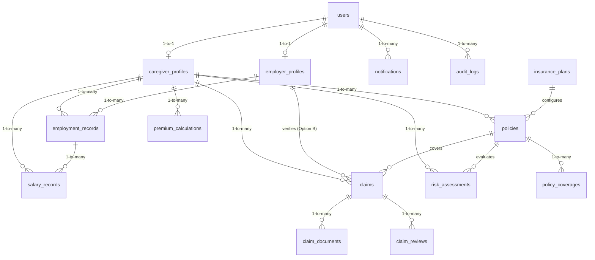

# CareGap AI – Database Schema Documentation

This document describes the relational database schema, tables, fields, constraints, indexes, and JSON column structures for the **CareGap AI** platform.

The system uses **SQLAlchemy 2.0+** ORM with dual-engine compatibility:
- **Production / Containerized:** PostgreSQL 16+
- **Local Development / Fast Testing:** SQLite 3 (Zero-config embedded)

---

## 1. Entity-Relationship Overview

---

## 2. Table Specifications

### 2.1 `users`
Core authentication and user management table.

| Column | Type | Constraints | Description |
|---|---|---|---|
| `id` | `INTEGER` | PRIMARY KEY, AUTO_INCREMENT | Unique user identifier |
| `email` | `VARCHAR(255)` | UNIQUE, NOT NULL, INDEX | Primary email / login identifier |
| `hashed_password` | `VARCHAR(255)` | NOT NULL | Bcrypt hashed credential |
| `role` | `VARCHAR(50)` | NOT NULL, DEFAULT `'caregiver'` | Role: `caregiver`, `employer`, `admin` |
| `is_active` | `BOOLEAN` | DEFAULT `TRUE` | Account active state |
| `is_verified` | `BOOLEAN` | DEFAULT `FALSE` | Email / onboarding completion flag |
| `created_at` | `DATETIME` | DEFAULT `UTC_NOW` | Account registration timestamp |
| `updated_at` | `DATETIME` | DEFAULT `UTC_NOW`, ON UPDATE | Last account update timestamp |

---

### 2.2 `caregiver_profiles`
Stores caregiver demographic, occupational, and bank verification records.

| Column | Type | Constraints | Description |
|---|---|---|---|
| `id` | `INTEGER` | PRIMARY KEY, AUTO_INCREMENT | Profile identifier |
| `user_id` | `INTEGER` | UNIQUE, NOT NULL, FK(`users.id`, CASCADE) | Associated user account |
| `full_name` | `VARCHAR(255)` | NOT NULL | Caregiver legal name |
| `mobile_number` | `VARCHAR(20)` | NOT NULL | Contact number |
| `date_of_birth` | `VARCHAR(20)` | NULLABLE | Format: `YYYY-MM-DD` |
| `city` | `VARCHAR(100)` | NOT NULL | Location city |
| `state` | `VARCHAR(100)` | NOT NULL | Location state |
| `pin_code` | `VARCHAR(10)` | NOT NULL | Postal code |
| `caregiver_category` | `VARCHAR(100)` | NOT NULL, DEFAULT `'Elderly Care'` | Category: `Elderly Care`, `Patient Care Assistant`, `Home Nurse`, `Specialized Care` |
| `years_experience` | `FLOAT` | NOT NULL, DEFAULT `1.0` | Total verified years in care work |
| `monthly_salary` | `FLOAT` | NOT NULL, DEFAULT `18000.0` | Declared monthly compensation (₹) |
| `employment_type` | `VARCHAR(100)` | NOT NULL, DEFAULT `'Full-Time Agency'` | `Full-Time Agency`, `Direct Household`, `Part-Time Independent` |
| `employer_name` | `VARCHAR(255)` | NULLABLE | Current agency or employer organization |
| `employment_start_date` | `VARCHAR(20)` | NULLABLE | Start date `YYYY-MM-DD` |
| `bank_verification_status`| `VARCHAR(50)` | DEFAULT `'pending'` | Status: `pending`, `verified`, `rejected` |
| `bank_name` | `VARCHAR(100)` | NULLABLE | Name of financial institution |
| `bank_account_last4` | `VARCHAR(4)` | NULLABLE | Masked display of last 4 digits (zero credential storage) |
| `ifsc_code` | `VARCHAR(20)` | NULLABLE | Bank branch routing IFSC code |
| `verification_documents` | `JSON` | DEFAULT `[]` | Document upload metadata |
| `profile_photo_url` | `VARCHAR(255)` | NULLABLE | Avatar URL |
| `created_at` | `DATETIME` | DEFAULT `UTC_NOW` | Profile creation timestamp |
| `updated_at` | `DATETIME` | DEFAULT `UTC_NOW`, ON UPDATE | Profile update timestamp |

---

### 2.3 `employer_profiles`
Stores care agency, hospital, or private household employer information.

| Column | Type | Constraints | Description |
|---|---|---|---|
| `id` | `INTEGER` | PRIMARY KEY, AUTO_INCREMENT | Employer identifier |
| `user_id` | `INTEGER` | UNIQUE, NOT NULL, FK(`users.id`, CASCADE) | Associated user account |
| `organization_name` | `VARCHAR(255)` | NOT NULL | Agency or hospital legal name |
| `organization_type` | `VARCHAR(100)` | NOT NULL, DEFAULT `'Care Agency'` | `Care Agency`, `Hospital/Clinic`, `Private Household` |
| `contact_person` | `VARCHAR(255)` | NOT NULL | Agency representative name |
| `mobile_number` | `VARCHAR(20)` | NOT NULL | Official contact phone |
| `registration_number` | `VARCHAR(100)` | NULLABLE | Corporate/agency registration number |
| `address` | `VARCHAR(255)` | NOT NULL | Head office address |
| `city` | `VARCHAR(100)` | NOT NULL | City |
| `state` | `VARCHAR(100)` | NOT NULL | State |
| `pin_code` | `VARCHAR(10)` | NOT NULL | Postal PIN code |
| `is_verified` | `BOOLEAN` | DEFAULT `FALSE` | Admin verification flag |
| `created_at` | `DATETIME` | DEFAULT `UTC_NOW` | Creation timestamp |
| `updated_at` | `DATETIME` | DEFAULT `UTC_NOW`, ON UPDATE | Update timestamp |

---

### 2.4 `employment_records`
Links caregivers with employers and tracks active/terminated contracts.

| Column | Type | Constraints | Description |
|---|---|---|---|
| `id` | `INTEGER` | PRIMARY KEY, AUTO_INCREMENT | Employment record identifier |
| `caregiver_id` | `INTEGER` | NOT NULL, FK(`caregiver_profiles.id`, CASCADE) | Employed caregiver |
| `employer_id` | `INTEGER` | NULLABLE, FK(`employer_profiles.id`, SET NULL) | Sponsoring employer profile |
| `employer_name` | `VARCHAR(255)` | NOT NULL | Employer organization name |
| `role_title` | `VARCHAR(100)` | NOT NULL, DEFAULT `'Senior Caregiver'` | Caregiver designation |
| `start_date` | `VARCHAR(20)` | NOT NULL | Employment start date `YYYY-MM-DD` |
| `end_date` | `VARCHAR(20)` | NULLABLE | Termination or completion date |
| `is_current` | `BOOLEAN` | DEFAULT `TRUE` | Whether currently active |
| `status` | `VARCHAR(50)` | DEFAULT `'active'` | `active`, `pending_verification`, `terminated`, `disputed` |
| `termination_date` | `VARCHAR(20)` | NULLABLE | Involuntary/voluntary end date |
| `termination_reason` | `TEXT` | NULLABLE | Termination circumstance |
| `employer_verified` | `BOOLEAN` | DEFAULT `FALSE` | Verified by employer account |
| `verification_notes` | `TEXT` | NULLABLE | Agency verification comments |
| `created_at` | `DATETIME` | DEFAULT `UTC_NOW` | Created timestamp |
| `updated_at` | `DATETIME` | DEFAULT `UTC_NOW`, ON UPDATE | Updated timestamp |

---

### 2.5 `salary_records`
Monthly salary disclosures and verification histories.

| Column | Type | Constraints | Description |
|---|---|---|---|
| `id` | `INTEGER` | PRIMARY KEY, AUTO_INCREMENT | Salary record identifier |
| `caregiver_id` | `INTEGER` | NOT NULL, FK(`caregiver_profiles.id`, CASCADE) | Caregiver |
| `employment_record_id` | `INTEGER` | NULLABLE, FK(`employment_records.id`, CASCADE) | Linked employment stint |
| `month` | `INTEGER` | NOT NULL | Month (1-12) |
| `year` | `INTEGER` | NOT NULL | Calendar year (e.g., 2026) |
| `declared_salary` | `FLOAT` | NOT NULL | Salary declared by caregiver (₹) |
| `verified_salary` | `FLOAT` | NULLABLE | Verified monthly remuneration (₹) |
| `salary_slip_url` | `VARCHAR(255)` | NULLABLE | File path / URL to proof |
| `is_verified` | `BOOLEAN` | DEFAULT `FALSE` | Employer verification flag |
| `verified_by_employer_id`| `INTEGER` | NULLABLE, FK(`employer_profiles.id`, SET NULL) | Employer verifier ID |
| `verification_date` | `DATETIME` | NULLABLE | Timestamp of verification |
| `created_at` | `DATETIME` | DEFAULT `UTC_NOW` | Submission timestamp |

---

### 2.6 `insurance_plans`
Illustrative insurance plan definitions (fully configurable by Administrators).

| Column | Type | Constraints | Description |
|---|---|---|---|
| `id` | `INTEGER` | PRIMARY KEY, AUTO_INCREMENT | Plan identifier |
| `plan_code` | `VARCHAR(50)` | UNIQUE, NOT NULL, INDEX | Code: `BASIC`, `PLUS`, `PREMIUM` |
| `name` | `VARCHAR(100)` | NOT NULL | Marketing name |
| `description` | `TEXT` | NOT NULL | Full plan scope |
| `coverage_option` | `VARCHAR(50)` | NOT NULL | `OPTION_A`, `COMBINED`, `COMBINED_PREMIUM` |
| `monthly_premium` | `FLOAT` | NOT NULL, DEFAULT `199.0` | Illustrative combined baseline monthly cost |
| `base_option_a_premium` | `FLOAT` | NOT NULL, DEFAULT `199.0` | Option A component price (₹) |
| `option_b_premium` | `FLOAT` | NOT NULL, DEFAULT `150.0` | Option B component price (₹) |
| `additional_benefits_premium`| `FLOAT` | NOT NULL, DEFAULT `150.0`| Optional benefits component price (₹) |
| `max_option_a_duration_days` | `INTEGER`| DEFAULT `60` | Maximum medical compensation duration |
| `max_option_b_duration_days` | `INTEGER`| DEFAULT `60` | Maximum transition compensation duration |
| `option_a_waiting_period_days`| `INTEGER`| DEFAULT `7` | Days before medical claim eligibility |
| `option_b_waiting_period_days`| `INTEGER`| DEFAULT `14` | Days before job loss claim eligibility |
| `min_qualifying_employment_months`| `INTEGER`| DEFAULT `3` | Minimum tenure before Option B unlocks |
| `coverage_limit_multiplier` | `FLOAT` | DEFAULT `1.0` | Max compensation as percentage of salary |
| `exclusions` | `JSON` | DEFAULT `[]` | List of excluded circumstances |
| `eligibility_conditions` | `JSON` | DEFAULT `[]` | List of qualification rules |
| `is_active` | `BOOLEAN` | DEFAULT `TRUE` | Whether open for new purchases |
| `created_at` | `DATETIME` | DEFAULT `UTC_NOW` | Creation timestamp |
| `updated_at` | `DATETIME` | DEFAULT `UTC_NOW`, ON UPDATE | Config change timestamp |

---

### 2.7 `policies`
Simulated active, lapsed, or grace-period caregiver insurance contracts.

| Column | Type | Constraints | Description |
|---|---|---|---|
| `id` | `INTEGER` | PRIMARY KEY, AUTO_INCREMENT | Policy identifier |
| `policy_number` | `VARCHAR(100)` | UNIQUE, NOT NULL, INDEX | Human-readable ID: `CG-POL-YYYY-XXXX` |
| `caregiver_id` | `INTEGER` | NOT NULL, FK(`caregiver_profiles.id`, CASCADE) | Insured caregiver |
| `plan_id` | `INTEGER` | NOT NULL, FK(`insurance_plans.id`) | Plan configuration reference |
| `coverage_type` | `VARCHAR(50)` | NOT NULL | `OPTION_A`, `OPTION_B`, `COMBINED` |
| `status` | `VARCHAR(50)` | DEFAULT `'active'` | `active`, `grace_period`, `lapsed`, `cancelled` |
| `start_date` | `DATETIME` | DEFAULT `UTC_NOW` | Effective start date |
| `renewal_date` | `DATETIME` | NOT NULL | Next billing / renewal date |
| `waiting_period_ends_at` | `DATETIME` | NOT NULL | End of claim waiting period |
| `monthly_premium` | `FLOAT` | NOT NULL | Monthly premium billed (₹) |
| `max_monthly_benefit` | `FLOAT` | NOT NULL | Monthly coverage ceiling (₹) |
| `declared_monthly_salary`| `FLOAT` | NOT NULL | Underwritten base salary (₹) |
| `terms_accepted` | `BOOLEAN` | DEFAULT `TRUE` | Prototype disclosure consent |
| `created_at` | `DATETIME` | DEFAULT `UTC_NOW` | Policy issuance timestamp |
| `updated_at` | `DATETIME` | DEFAULT `UTC_NOW`, ON UPDATE | Policy update timestamp |

---

### 2.8 `policy_coverages`
Itemized sub-coverages included inside each policy.

| Column | Type | Constraints | Description |
|---|---|---|---|
| `id` | `INTEGER` | PRIMARY KEY, AUTO_INCREMENT | Coverage item ID |
| `policy_id` | `INTEGER` | NOT NULL, FK(`policies.id`, CASCADE) | Parent policy |
| `coverage_type` | `VARCHAR(50)` | NOT NULL | `OPTION_A`, `OPTION_B`, `ADDITIONAL_PERKS` |
| `benefit_percentage` | `FLOAT` | DEFAULT `100.0` | Coverage rate (% of regular salary) |
| `max_duration_days` | `INTEGER` | DEFAULT `60` | Maximum claimable benefit days |
| `current_utilized_days` | `INTEGER` | DEFAULT `0` | Cumulative claimed days in policy cycle |
| `coverage_amount` | `FLOAT` | NOT NULL | Maximum aggregate compensation amount |
| `terms` | `JSON` | DEFAULT `{}` | Specific sub-coverage terms |

---

### 2.9 `premium_calculations`
Audit log of deterministic premium computations and user quotes.

| Column | Type | Constraints | Description |
|---|---|---|---|
| `id` | `INTEGER` | PRIMARY KEY, AUTO_INCREMENT | Calculation identifier |
| `caregiver_id` | `INTEGER` | NOT NULL, FK(`caregiver_profiles.id`, CASCADE) | Caregiver quoted |
| `calculated_for_salary` | `FLOAT` | NOT NULL | Input salary amount (₹) |
| `selected_plan_id` | `INTEGER` | NULLABLE | Selected plan ID |
| `selected_coverage` | `VARCHAR(50)` | NOT NULL | `OPTION_A`, `OPTION_B`, `COMBINED`, `PREMIUM` |
| `base_rate` | `FLOAT` | NOT NULL | Base plan rate |
| `category_factor` | `FLOAT` | DEFAULT `1.0` | Occupational risk multiplier |
| `tenure_discount` | `FLOAT` | DEFAULT `0.0` | Loyalty discount amount (₹) |
| `risk_adjustment` | `FLOAT` | DEFAULT `0.0` | Shift / hazards surcharge (₹) |
| `final_calculated_premium`| `FLOAT` | NOT NULL | Final quoted monthly premium (₹) |
| `calculation_breakdown` | `JSON` | DEFAULT `{}` | Full step-by-step math dictionary |
| `created_at` | `DATETIME` | DEFAULT `UTC_NOW` | Quote generation timestamp |

---

### 2.10 `risk_assessments`
Google Gemini-powered risk assessment assisted evaluations with human underwriter sign-off.

| Column | Type | Constraints | Description |
|---|---|---|---|
| `id` | `INTEGER` | PRIMARY KEY, AUTO_INCREMENT | Assessment identifier |
| `caregiver_id` | `INTEGER` | NOT NULL, FK(`caregiver_profiles.id`, CASCADE) | Assessed caregiver |
| `policy_id` | `INTEGER` | NULLABLE, FK(`policies.id`, SET NULL) | Linked policy if issued |
| `risk_category` | `VARCHAR(50)` | DEFAULT `'LOW'` | `LOW`, `MODERATE`, `HIGH` |
| `risk_score` | `INTEGER` | DEFAULT `25` | Score from 0 (safest) to 100 (highest risk) |
| `risk_factors` | `JSON` | DEFAULT `[]` | List of identified occupational factors |
| `recommendations` | `JSON` | DEFAULT `[]` | AI-suggested policy mitigations |
| `explanation` | `TEXT` | NOT NULL | Transparent natural language rationale |
| `assessed_by_ai` | `BOOLEAN` | DEFAULT `TRUE` | Whether generated by Gemini / fallback |
| `human_reviewed` | `BOOLEAN` | DEFAULT `FALSE` | Underwriter sign-off flag |
| `human_reviewer_id` | `INTEGER` | NULLABLE, FK(`users.id`, SET NULL) | Admin underwriter user ID |
| `reviewer_notes` | `TEXT` | NULLABLE | Underwriter remarks |
| `created_at` | `DATETIME` | DEFAULT `UTC_NOW` | Timestamp of assessment |
| `updated_at` | `DATETIME` | DEFAULT `UTC_NOW`, ON UPDATE | Timestamp of human sign-off |

---

### 2.11 `claims`
Income protection claims filed by caregivers.

| Column | Type | Constraints | Description |
|---|---|---|---|
| `id` | `INTEGER` | PRIMARY KEY, AUTO_INCREMENT | Claim identifier |
| `claim_number` | `VARCHAR(100)` | UNIQUE, NOT NULL, INDEX | Human-readable ID: `CG-CLM-YYYY-XXXX` |
| `policy_id` | `INTEGER` | NOT NULL, FK(`policies.id`, CASCADE) | Associated policy |
| `caregiver_id` | `INTEGER` | NOT NULL, FK(`caregiver_profiles.id`, CASCADE) | Claimant caregiver |
| `claim_type` | `VARCHAR(50)` | NOT NULL | `OPTION_A` (Illness/Injury), `OPTION_B` (Job Loss) |
| `incident_date` | `VARCHAR(20)` | NULLABLE | Option A incident date `YYYY-MM-DD` |
| `incident_description` | `TEXT` | NULLABLE | Medical circumstance |
| `interruption_start_date`| `VARCHAR(20)`| NULLABLE | First day unable to work |
| `expected_recovery_date` | `VARCHAR(20)`| NULLABLE | Expected return-to-work date |
| `termination_date` | `VARCHAR(20)` | NULLABLE | Option B job termination date |
| `termination_reason` | `TEXT` | NULLABLE | Employer termination reason |
| `employer_id` | `INTEGER` | NULLABLE, FK(`employer_profiles.id`, SET NULL) | Employer verification agency |
| `employer_name` | `VARCHAR(255)` | NULLABLE | Agency name |
| `employer_contact` | `VARCHAR(100)` | NULLABLE | Agency phone/email |
| `last_working_date` | `VARCHAR(20)` | NULLABLE | Final shift date |
| `previous_monthly_salary`| `FLOAT` | NULLABLE | Verified historical salary |
| `claimed_salary` | `FLOAT` | NOT NULL, DEFAULT `18000.0` | Base salary on which claim is computed |
| `calculated_benefit_amount`| `FLOAT` | NOT NULL, DEFAULT `0.0` | Algorithmic entitlement |
| `approved_benefit_amount`| `FLOAT` | NULLABLE | Final underwriter approved payout (₹) |
| `benefit_duration_days` | `INTEGER` | DEFAULT `30` | Number of days compensated |
| `status` | `VARCHAR(50)` | DEFAULT `'SUBMITTED'`, INDEX | Workflow stage (see State Machine) |
| `admin_notes` | `TEXT` | NULLABLE | Internal adjudication comments |
| `employer_notes` | `TEXT` | NULLABLE | Employer verification feedback |
| `employer_verified` | `BOOLEAN` | DEFAULT `FALSE` | Employer confirmation flag |
| `rejection_reason` | `TEXT` | NULLABLE | Detailed rejection rationale if denied |
| `fraud_flag` | `BOOLEAN` | DEFAULT `FALSE` | Automated anomaly / fraud alert flag |
| `fraud_reasons` | `JSON` | DEFAULT `[]` | List of trigger anomalies |
| `ai_summary` | `TEXT` | NULLABLE | Gemini synthesized claim brief |
| `decision_date` | `DATETIME` | NULLABLE | Final decision timestamp |
| `created_at` | `DATETIME` | DEFAULT `UTC_NOW` | Filing timestamp |
| `updated_at` | `DATETIME` | DEFAULT `UTC_NOW`, ON UPDATE | Last stage transition timestamp |

---

### 2.12 `claim_documents`
Files attached to claims (medical records, termination notices, salary slips).

| Column | Type | Constraints | Description |
|---|---|---|---|
| `id` | `INTEGER` | PRIMARY KEY, AUTO_INCREMENT | Document identifier |
| `claim_id` | `INTEGER` | NOT NULL, FK(`claims.id`, CASCADE) | Associated claim |
| `document_type` | `VARCHAR(100)` | NOT NULL | `medical_certificate`, `discharge_summary`, `termination_letter`, `salary_slip` |
| `file_name` | `VARCHAR(255)` | NOT NULL | Original or sanitized filename |
| `file_path` | `VARCHAR(500)` | NOT NULL | Local or cloud storage URI |
| `file_size` | `INTEGER` | NOT NULL, DEFAULT `0` | Size in bytes |
| `mime_type` | `VARCHAR(100)` | NOT NULL, DEFAULT `'application/pdf'` | MIME content type |
| `extracted_data` | `JSON` | DEFAULT `{}` | Gemini OCR extracted entities (doctor, dates, diagnosis) |
| `ai_validation_status` | `VARCHAR(50)` | DEFAULT `'pending'` | `pending`, `valid`, `flagged`, `inconclusive` |
| `ai_validation_notes` | `TEXT` | NULLABLE | Gemini document audit remarks |
| `uploaded_at` | `DATETIME` | DEFAULT `UTC_NOW` | Upload timestamp |

---

### 2.13 `claim_reviews`
Audit log of underwriter interventions, employer confirmations, and AI reviews.

| Column | Type | Constraints | Description |
|---|---|---|---|
| `id` | `INTEGER` | PRIMARY KEY, AUTO_INCREMENT | Review identifier |
| `claim_id` | `INTEGER` | NOT NULL, FK(`claims.id`, CASCADE) | Inspected claim |
| `reviewer_id` | `INTEGER` | NULLABLE, FK(`users.id`, SET NULL) | User conducting review |
| `review_type` | `VARCHAR(50)` | NOT NULL | `admin_review`, `employer_verification`, `ai_assistant_summary` |
| `status` | `VARCHAR(50)` | NOT NULL | Status after review |
| `comments` | `TEXT` | NULLABLE | Evaluator comments |
| `flags` | `JSON` | DEFAULT `[]` | Red flags noted |
| `created_at` | `DATETIME` | DEFAULT `UTC_NOW` | Review timestamp |

---

### 2.14 `notifications`
In-app notification messages delivered to caregivers, employers, or admins.

| Column | Type | Constraints | Description |
|---|---|---|---|
| `id` | `INTEGER` | PRIMARY KEY, AUTO_INCREMENT | Notification identifier |
| `user_id` | `INTEGER` | NOT NULL, FK(`users.id`, CASCADE) | Recipient user |
| `title` | `VARCHAR(255)` | NOT NULL | Headline |
| `message` | `TEXT` | NOT NULL | Message body |
| `notification_type` | `VARCHAR(50)` | DEFAULT `'system'` | `policy`, `claim`, `verification`, `system` |
| `is_read` | `BOOLEAN` | DEFAULT `FALSE` | Read / unread status |
| `metadata_json` | `JSON` | DEFAULT `{}` | Contextual links (claim_id, policy_id) |
| `created_at` | `DATETIME` | DEFAULT `UTC_NOW` | Generation timestamp |

---

### 2.15 `audit_logs`
Immutable compliance audit trail tracking all state changes, logins, policy issuances, and claim reviews.

| Column | Type | Constraints | Description |
|---|---|---|---|
| `id` | `INTEGER` | PRIMARY KEY, AUTO_INCREMENT | Audit log identifier |
| `user_id` | `INTEGER` | NULLABLE, FK(`users.id`, SET NULL) | Actor who triggered the action |
| `action` | `VARCHAR(100)` | NOT NULL | `CREATE_POLICY`, `SUBMIT_CLAIM`, `APPROVE_CLAIM`, etc. |
| `entity_type` | `VARCHAR(50)` | NOT NULL | `user`, `policy`, `claim`, `plan` |
| `entity_id` | `VARCHAR(50)` | NULLABLE | ID of target resource |
| `ip_address` | `VARCHAR(50)` | NULLABLE | Client IP address |
| `details` | `JSON` | DEFAULT `{}` | Full before/after metadata payload |
| `created_at` | `DATETIME` | DEFAULT `UTC_NOW` | Audit timestamp |

---

## 3. Database Indexes & Performance Optimizations

1. **`users(email)`**: Unique index for sub-millisecond login credential lookups.
2. **`policies(policy_number)`**: Unique index for instantaneous policy verification.
3. **`claims(claim_number)`**: Unique index for public claim reference tracking.
4. **`claims(status)`**: B-tree index enabling high-performance queue filtering in Admin Dashboard.
5. **Foreign Key Indexes**: Foreign keys are indexed by default in PostgreSQL to optimize joined queries between Caregivers, Policies, Coverages, and Claims.

