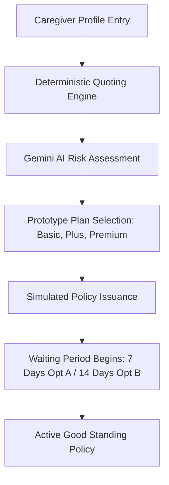
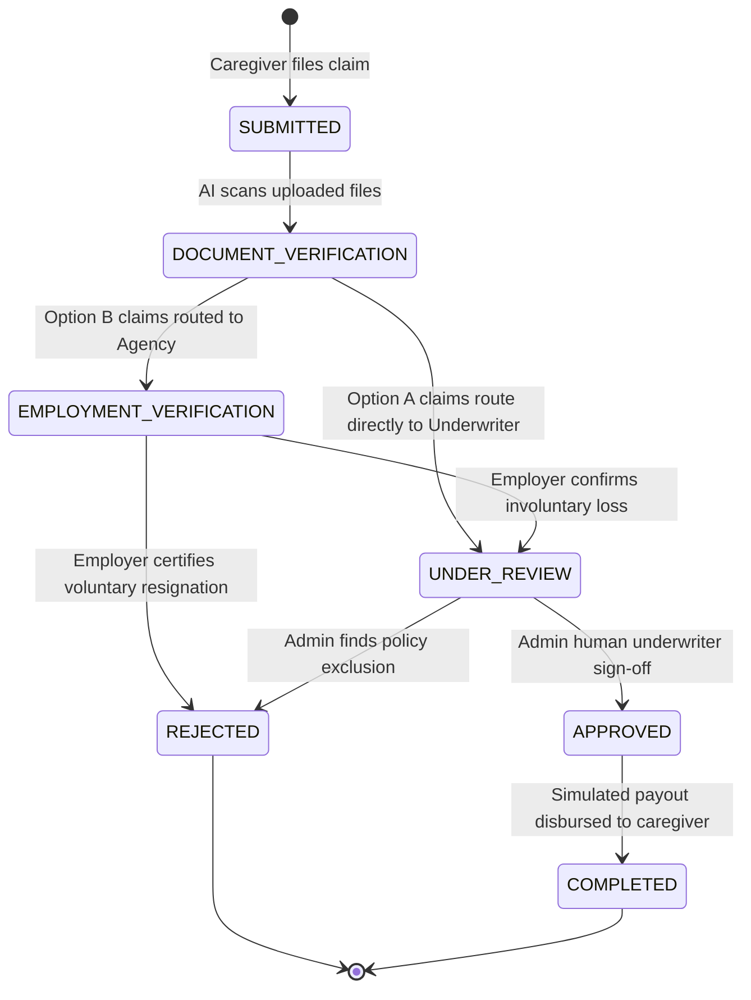

# CareGap AI – Insurance & Claims Workflow Documentation

> **Important Regulatory Disclaimer:**
> **CareGap AI** is an academic insurance technology prototype designed to explore financial safety nets for informal and formal healthcare workers. Simulated policies, quotations, risk scores, and claim settlements generated by this platform are for demonstration and educational purposes only. They do not constitute legally binding contracts under the Insurance Regulatory and Development Authority of India (IRDAI) or applicable national insurance laws.

---

## 1. Dual-Protection Paradigm

Professional caregivers (elderly companions, home nurses, patient attendants) operate in high-volatility environments facing two distinct income shocks:

| Feature | Option A: Personal Income Protection | Option B: Employment Continuity Protection |
|---|---|---|
| **Primary Risk Addressed** | Temporary physical inability to work due to illness or accidental injury | Involuntary job displacement when patient care is discontinued |
| **Trigger Event** | Medically verified sickness, surgery, or orthopedic injury | Patient death, recovery, hospital transfer, or family relocation |
| **Illustrative Monthly Cost** | ₹199 / month (Basic) | Included in Plus (₹349) and Premium (₹499) |
| **Benefit Structure** | Daily wage replacement for documented inability to work | Lump-sum or multi-week bridge income replacement |
| **Benefit Rate** | 100% of declared monthly salary / 30 per eligible day | Up to 100% of monthly salary for transition period |
| **Initial Waiting Period** | 7 days from policy inception | 14 days from policy inception |
| **Tenure Requirement** | Eligible upon policy activation | Minimum 3 months continuous employment |
| **Verification Authority** | Registered Medical Practitioner / Hospital Discharge | Sponsoring Agency or Household Employer |

---

## 2. Policy Inception & Quoting Workflow

### Deterministic Premium Formulation
Premiums are calculated using transparent formulas:
$$\text{Adjusted Premium} = \left(\text{Base Rate} \times \text{Category Multiplier}\right) - \text{Tenure Discount} + \text{Occupational Surcharge}$$

- **Base Rates:** Option A = ₹199; Option B = ₹150; Premium Perks = ₹150.
- **Category Multipliers:**
  - Elderly Care: $1.0\times$
  - Patient Care Assistant: $1.05\times$
  - Home Nurse: $1.10\times$
  - Specialized Critical Care: $1.15\times$
- **Tenure Stability Discounts:**
  - $\ge 5$ years verified experience: 10% discount
  - $\ge 3$ years verified experience: 5% discount
  - $< 3$ years: 0% discount
- **Occupational Risk Adjustments:**
  - Night Shift Care: +₹20
  - High-Dependency Patient Handling: +₹25
  - Multi-Home Commute: +₹15

---

## 3. Claim Lifecycle State Machine

### Detailed Stage Breakdown

#### 1. `SUBMITTED`
- **Actor:** Caregiver
- **Action:** Caregiver fills claim form, selects active policy, declares incident/termination details, and uploads supporting documents.
- **System Output:** Generates unique tracking ID (e.g., `CG-CLM-2026-0042`) and fires an automated confirmation notification.

#### 2. `DOCUMENT_VERIFICATION`
- **Actor:** Automated System / Gemini AI Document Service
- **Action:** Optical entity extraction inspects uploaded files (medical certificates, termination notices, pay slips).
- **Checks:**
  - Identifies issuing physician / clinic name and diagnosis.
  - Checks if medical dates align with the claimed incapacity timeline.
  - Flags blurred, incomplete, or corrupted files for human re-upload requests.

#### 3. `EMPLOYMENT_VERIFICATION` (Option B Claims Only)
- **Actor:** Employer / Care Agency
- **Privacy Boundary:** Agency receives a verification request containing **only** employment dates, termination date, and stated reason. Agency has **zero access** to any personal medical records or Option A claim histories.
- **Actions:**
  - **Confirm:** Certifies involuntary dismissal due to patient condition or contract end.
  - **Dispute:** Declares voluntary resignation, job abandonment, or gross misconduct.

#### 4. `UNDER_REVIEW`
- **Actor:** Administrator / Licensed Underwriter
- **Inputs:** Algorithmic eligibility results + AI Document Summary + Agency verification logs.
- **Eligibility Engine Rules:**
  - **Option A Eligibility:** Policy is `active`, incident occurred outside the 7-day waiting window, claimed interruption $\le 60$ days, no excluded conditions (cosmetic, self-inflicted).
  - **Option B Eligibility:** Policy is `active`, termination occurred outside the 14-day waiting window, caregiver tenure $\ge 3$ months, reason matches involuntary qualification keywords.
- **Actions:**
  - **Approve:** Authorizes full or capped benefit payout.
  - **Request Documents:** Asks caregiver for hospital discharge summary or stamp.
  - **Reject:** Documents formal reason (e.g., "Voluntary departure during waiting window").

#### 5. `APPROVED` & `COMPLETED`
- **System Action:** Computes exact simulated payout, logs the approval into immutable `audit_logs`, releases simulated funds to the caregiver's registered account, and marks claim status as `COMPLETED`.

---

## 4. Algorithmic Payout Calculations

### Option A Payout Formula
$$\text{Daily Benefit Rate} = \frac{\text{Declared Monthly Salary}}{30}$$
$$\text{Billable Days} = \min(\text{Interruption Days}, 60)$$
$$\text{Option A Payout} = \text{Daily Benefit Rate} \times \text{Billable Days}$$

*Example:*
- Declared Salary: ₹18,000 / month
- Daily Rate: ₹600 / day
- Medically Certified Incapacity: 21 days
- Total Approved Payout: $21 \times 600 = \text{₹}12,600$

### Option B Payout Formula
- Provides **1 full month** of base salary income continuity support:
$$\text{Option B Payout} = \text{Declared Monthly Salary} \times \text{Plan Multiplier (1.0)}$$
- Extendable to 60 days on configured multi-month Premium plans.

---

## 5. AI Safety & Human-in-the-Loop Governance

1. **Deterministic Financial Protection:** AI never creates or guesses financial values. All calculations are executed by deterministic Python service modules (`premium_engine.py` and `eligibility_engine.py`).
2. **Decision Support, Not Decision Maker:** Google Gemini provides document summarization, entity extraction, and risk factor identification. It **cannot** automatically approve or deny any claim.
3. **Graceful Fallback:** If the Gemini API is unreachable, has high latency, or encounters rate limits, the system switches to built-in rule heuristics without interrupting user workflows.
4. **Transparent Risk Factors:** Risk assessments explicitly state why a category was assigned (e.g., "Night shifts involve higher physiological fatigue"), preventing black-box rejections.

